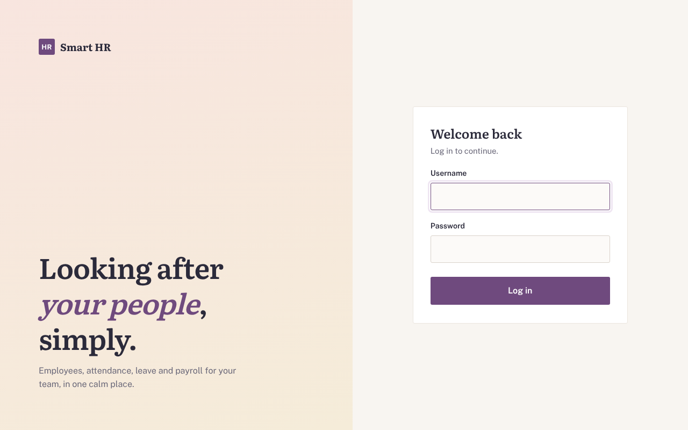
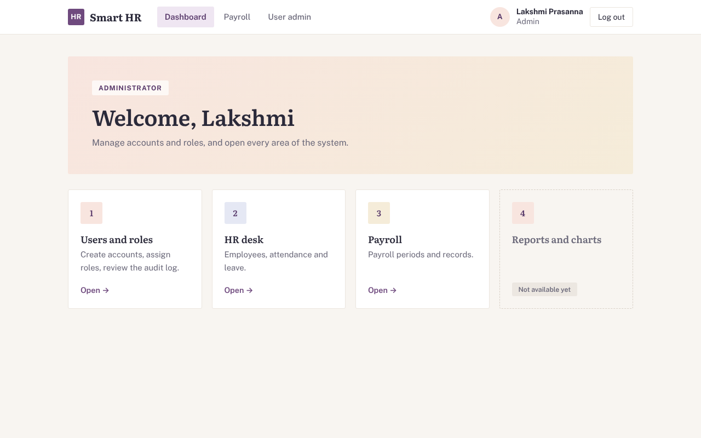
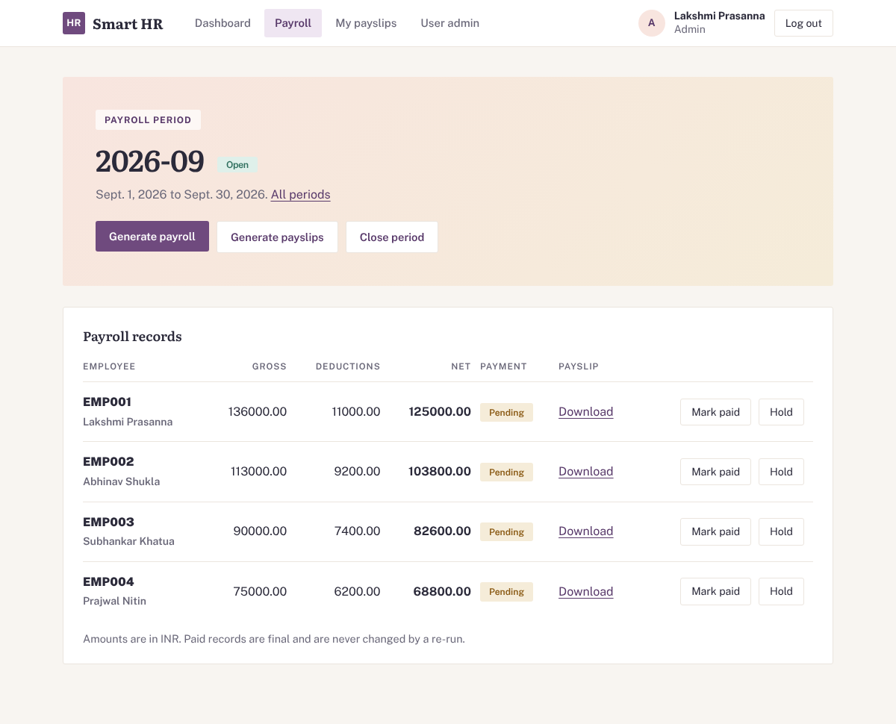
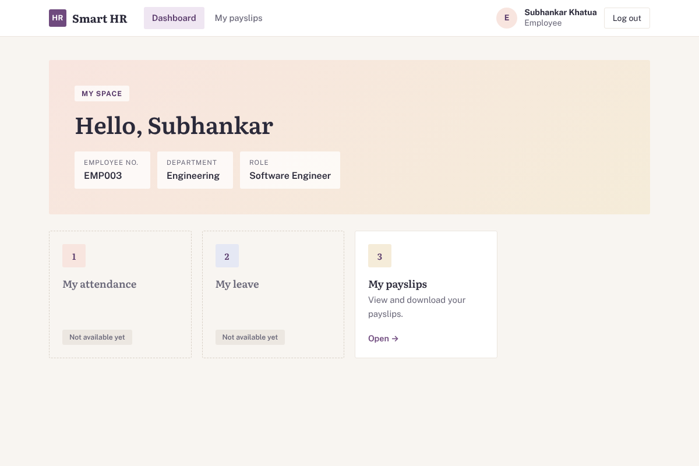
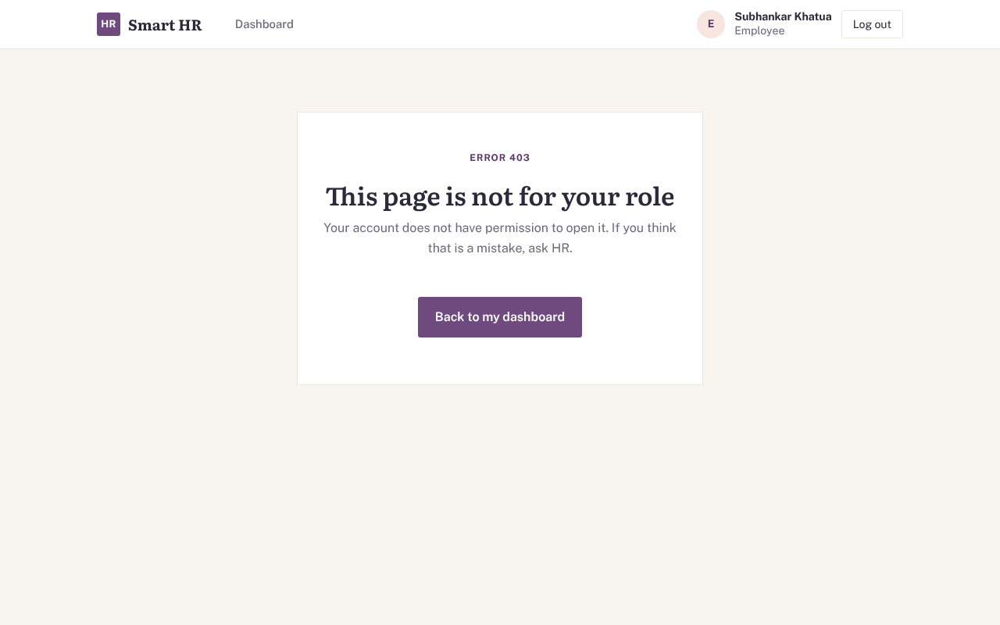
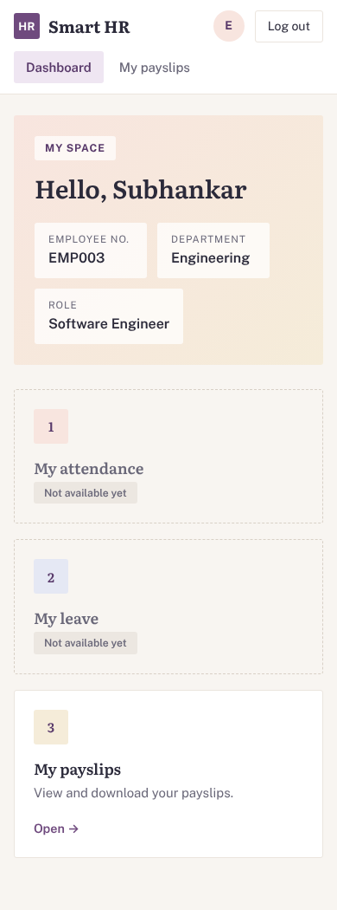
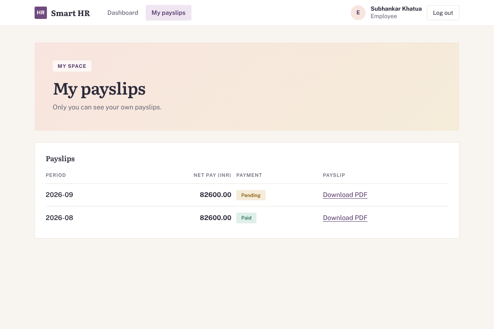
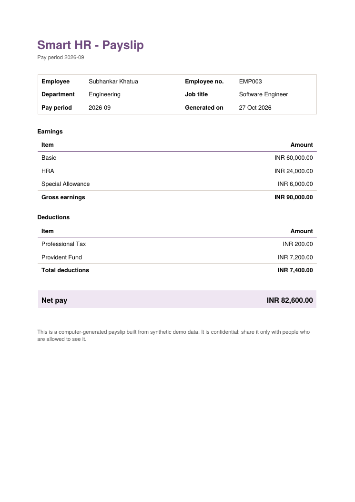

# Smart HR & Employee Management System

A Django web application for managing employees, departments, attendance,
leave requests and payroll, with separate Admin, HR and Employee dashboards.

**Stack:** Python 3.11+, Django 5.2, Django REST Framework, PostgreSQL
(SQLite for a quick local start), pytest.

## Project status

| Week | Focus | Status |
|------|-------|--------|
| 1 | Requirements, data model, authentication, role-aware dashboards, tests | Done |
| 2 | Employee, attendance and leave workflows | Done |
| 3 | Payroll, payslips, e-mail notifications | Done |
| 4 | Charts, reports, security review, final docs | Planned |

### What Week 1 delivers

* Custom user model with three roles: Admin, HR, Employee.
* Login, logout and role-aware dashboard shells (Admin, HR, Employee).
* Role checks for web views (`role_required`) and for the API (DRF permission classes).
* Database schema and migrations for users, departments, employees, attendance,
  leave, payroll and audit/notification logs.
* A payroll page and payroll API that prove the access boundary: Employees
  cannot reach the page and see only their own records through the API.
* Logging to the console and `logs/app.log`; login events written to the audit log.
* 33 automated tests, covering authentication, the role matrix, model rules and payroll access.
* Documentation in `docs/`: [requirements](docs/requirements.md),
  [role-permission matrix](docs/role_permission_matrix.md),
  [schema notes and ER diagram](docs/schema.md).

### What Week 2 delivers

* Employee directory API: Admin/HR read full records (including personal
  fields) and create employees; other roles get a public directory view with
  personal fields stripped. Filtering by department, status and code search.
* Attendance API: employees check in / check out once per day (duplicate or
  out-of-order attempts return `409`), plus a monthly per-employee summary
  restricted to Admin/HR.
* Leave API: employees submit requests for themselves; Admin/HR approve or
  reject; the owner (or Admin/HR) may cancel a pending request. Every status
  change is validated against the state machine in
  `apps/leave_management/states.py` and written to `LeaveStatusHistory`.
* 17 additional tests covering the directory privacy boundary, attendance
  rules and the leave approval workflow (50 tests in total).

### What Week 3 delivers

* **Salary setup (Admin/HR):** a catalogue of salary components (earnings and
  deductions, fixed or a percentage of Basic) and each employee's values.
  Every change is written to the audit log.
* **Payroll periods and records:** create a period for a month, then generate
  the payroll for everyone who has salary set up. Re-running is safe: paid
  records are never changed, unpaid records are refreshed, and anything that
  cannot be calculated is reported. Payment status moves pending, on hold,
  paid (paid is final); a period can be closed only when nothing is pending.
* **Payslips:** a PDF per payroll record built from a snapshot of its salary
  lines. Employees download only their own (`/payroll/my/`); Admin and HR can
  download any. Files are served through a permission-checked view, never
  from a public media URL.
* **E-mail notifications:** employees are e-mailed when a payslip is issued
  (no salary figures in the e-mail) and when a leave request is approved or
  rejected. Every attempt is stored in `NotificationLog` as sent or failed; a
  mail outage never breaks the action that triggered it.
* **Pages:** Payroll (periods, records, payslips, payment status) for Admin/HR
  and My payslips for everyone.
* Tests for payroll rules, payslips, access restrictions, notifications and the
  pages (all tests pass; see Run the tests).

## Screenshots

| Login | Admin dashboard |
|---|---|
|  |  |

| Payroll period (Admin and HR only) | Employee dashboard |
|---|---|
|  |  |

| Access denied (Employee opening /payroll/) | Employee dashboard on a phone |
|---|---|
|  |  |

| My payslips (each employee sees only their own) | Sample payslip PDF (synthetic data) |
|---|---|
|  |  |

A step-by-step walkthrough for showing the app is in [docs/demo_script.md](docs/demo_script.md).

## Prerequisites

* Python 3.11 or newer
* Git
* PostgreSQL 14+ (optional for a first run; required for the final setup)

## Installation

Windows PowerShell:

```powershell
git clone <your-repo-url>
cd Smart-HR-Employee-Management-System
python -m venv venv
venv\Scripts\activate
pip install -r requirements.txt
copy .env.example .env
```

macOS / Linux:

```bash
git clone <your-repo-url>
cd Smart-HR-Employee-Management-System
python3 -m venv venv
source venv/bin/activate
pip install -r requirements.txt
cp .env.example .env
```

## Environment variables

All settings are read from `.env` (never commit that file). `.env.example`
lists every variable with placeholder values.

| Variable | Purpose | Default |
|---|---|---|
| `DEBUG` | Debug mode. Must be `False` in production. | `True` |
| `SECRET_KEY` | Django secret key. Required when `DEBUG=False`. | dev-only key when debugging |
| `ALLOWED_HOSTS` | Comma-separated host names. | `localhost,127.0.0.1` |
| `TIME_ZONE` | Django time zone. | `Asia/Kolkata` |
| `LOG_LEVEL` | Logging level. | `INFO` |
| `DB_ENGINE` | `sqlite` or `postgres`. | `sqlite` |
| `DB_NAME`, `DB_USER`, `DB_PASSWORD`, `DB_HOST`, `DB_PORT` | PostgreSQL connection (used when `DB_ENGINE=postgres`). | `smart_hr`, `postgres`, empty, `localhost`, `5432` |
| `EMAIL_*`, `DEFAULT_FROM_EMAIL` | E-mail settings for notifications. | console backend (prints e-mails in the terminal) |
| `SITE_URL` | Base address used for links inside e-mails. | `http://localhost:8000` |
| `SEED_PASSWORD` | Password for demo accounts created by the seed script. | `Demo@12345` |

Generate a secret key with:

```
python -c "from django.core.management.utils import get_random_secret_key as g; print(g())"
```

## Database setup

### Option A: SQLite (fastest way to try the app)

Leave `DB_ENGINE=sqlite` in `.env`. The database file `db.sqlite3` is created
on the first migration and is git-ignored.

### Option B: PostgreSQL (the intended setup)

1. Install PostgreSQL and open `psql` (or pgAdmin) as the `postgres` user.
2. Create the database:

   ```sql
   CREATE DATABASE smart_hr;
   ```

3. In `.env` set:

   ```
   DB_ENGINE=postgres
   DB_NAME=smart_hr
   DB_USER=postgres
   DB_PASSWORD=<the password you chose during installation>
   DB_HOST=localhost
   DB_PORT=5432
   ```

### Create the tables

```
python manage.py migrate
```

## Demo data

Creates one login per role, three departments, employee profiles, four
leave types, salary components and two payroll periods (August closed and
paid, September open) with payslips. All data is synthetic. Safe to re-run.

```
python scripts/seed_demo_data.py
```

| Username | Role | Password |
|---|---|---|
| `admin_demo` | Admin | value of `SEED_PASSWORD` |
| `hr_demo` | HR | value of `SEED_PASSWORD` |
| `employee_demo` | Employee | value of `SEED_PASSWORD` |
| `employee_demo2` | Employee | value of `SEED_PASSWORD` |

To make your own Admin instead: `python manage.py createsuperuser`
(superusers created this way get the Admin role automatically).

## Run the application

```
python manage.py runserver
```

Open http://127.0.0.1:8000/ and log in. Each role lands on its own dashboard:

| URL | Admin | HR | Employee |
|---|---|---|---|
| `/dashboard/admin/` | yes | no | no |
| `/dashboard/hr/` | yes | yes | no |
| `/dashboard/employee/` | yes | yes | yes |
| `/payroll/` and `/payroll/periods/<id>/` | yes | yes | no |
| `/payroll/my/` | own | own | own |
| `/payroll/payslips/<id>/download/` | any | any | own |
| `/api/accounts/me/` | yes | yes | yes |
| `/api/employees/employees/` | full | full | directory only |
| `/api/attendance/checkin/`, `/checkout/` | own | own | own |
| `/api/attendance/records/` | all | all | own |
| `/api/attendance/summary/` | yes | yes | no |
| `/api/leave/requests/` | all | all | own |
| `/api/leave/requests/<id>/decide/` | decide | decide | cancel own |
| `/api/payroll/records/` (`?period=YYYY-MM`) | all rows | all rows | own rows |
| `/api/payroll/records/<id>/status/` | yes | yes | no |
| `/api/payroll/periods/` and `.../<id>/generate/`, `/payslips/`, `/close/` | yes | yes | no |
| `/api/payroll/components/` and `/api/payroll/employee-salary/` | yes | yes | no |
| `/admin/` (Django admin) | yes | no | no |

## Run the tests

```
python -m pytest
```

Useful variations: `python -m pytest -v` for a test-by-test list, and
`python -m pytest tests/test_payroll_access.py` for one file.

## Project structure

```
config/                  Django settings, URLs, WSGI/ASGI
apps/
  accounts/              User model with roles, login/dashboards, permission helpers
  employees/             Department, Employee
  attendance/            Attendance
  leave_management/      LeaveType, LeaveRequest, LeaveStatusHistory, state rules
  payroll/               Periods, salary components, records, payslip PDFs, pages + API
  reports/               AuditEvent, NotificationLog, audit and e-mail services
templates/               HTML templates (base, login, dashboards, payroll, e-mails, 403)
static/                  CSS
tests/                   pytest test suite
scripts/                 seed_demo_data.py
docs/                    Requirements, role matrix, schema notes, ER diagram
.env.example             Environment variable placeholders
requirements.txt         Python dependencies
```

## Team workflow (Git)

* `main` always contains working, reviewed code. Do not commit to it directly.
* Create one branch per piece of work, for example `week2-employees` or
  `week2-leave-workflow`, starting from the latest `main`.
* Commit small and often with messages like `feat(leave): add approve and
  reject actions` or `test(attendance): cover duplicate check-in`.
* Open a pull request into `main`, let the team lead review it, then merge.
* Never commit `.env`, `db.sqlite3`, `logs/`, `media/` or real personal data.

## Known limitations

* The Admin, HR and Employee dashboards still show placeholder cards for features planned for Week 4.
* Charts and CSV/Excel/PDF report exports are not built yet (Week 4).
* Payroll is a full month per employee: there is no proration for part-month joiners, no tax slabs and no overtime.
* E-mails are sent straight away, not through a background queue (Celery/Redis); failures are logged and can be re-tried by regenerating.
* Salary components, periods and records are managed through the pages and API; there is no bulk import.
* Attendance and leave are exposed through the API only; web screens for them
  are planned for a later sprint.
* Tests run on whichever database `.env` selects; the full suite passes on SQLite.
* KPI definitions and deployment notes are added in Week 4.

## Contributors

Built as a two-person team.

* **Lakshmi Prasanna** ([@lakshmiprasanna-85](https://github.com/lakshmiprasanna-85)) —
  project lead; core data model and schema, authentication and the role-permission
  matrix, payroll access boundary, test harness.
* **Abhinav Shukla** ([@abhinavshukla152005-beep](https://github.com/abhinavshukla152005-beep)) —
  employee directory, attendance check-in/out with monthly summary, the leave
  approval state machine and status history, and the Week 2 test suite.
