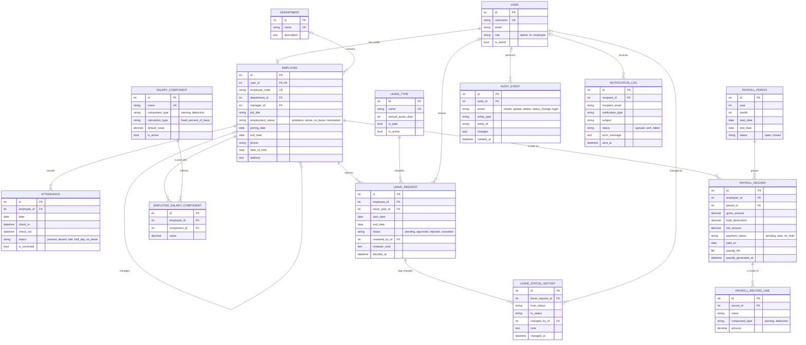

# Database schema notes

The diagram below renders automatically on GitHub. A PNG copy is in
`docs/er_diagram.png`.

## Where each table lives

| Django app | Tables |
|---|---|
| `accounts` | `User` |
| `employees` | `Department`, `Employee` |
| `attendance` | `Attendance` |
| `leave_management` | `LeaveType`, `LeaveRequest`, `LeaveStatusHistory` |
| `payroll` | `PayrollPeriod`, `SalaryComponent`, `EmployeeSalaryComponent`, `PayrollRecord`, `PayrollRecordLine` |
| `reports` | `AuditEvent`, `NotificationLog` |

## Integrity rules enforced by the database

| Table | Rule | Constraint name |
|---|---|---|
| Employee | One employee record per user | `user` one-to-one |
| Employee | Unique `employee_code` | unique field |
| Employee | `exit_date` is empty or not before `joining_date` | `employee_exit_not_before_joining` |
| Attendance | One row per employee per day | `uniq_attendance_employee_date` |
| Attendance | `check_out` after `check_in` when both are set | `attendance_checkout_after_checkin` |
| LeaveRequest | `end_date` not before `start_date` | `leave_end_not_before_start` |
| PayrollPeriod | One period per year and month | `uniq_payroll_period_year_month` |
| EmployeeSalaryComponent | One value per employee per component | `uniq_employee_salary_component` |
| PayrollRecord | One record per employee per period | `uniq_payroll_employee_period` |
| PayrollRecord | Gross and deductions are not negative | `payroll_amounts_not_negative` |

## Delete behaviour (why each `on_delete` was chosen)

* `Employee.department` is `SET_NULL`: removing a department keeps its people.
* `Employee.user` is `CASCADE`: an employee record has no meaning without its login.
* `PayrollRecordLine.record` is `CASCADE`: the lines are a snapshot owned by their record.
* `PayrollRecord.employee` and `.period` are `PROTECT`: payroll history cannot be
  lost by deleting an employee or a period.
* `LeaveRequest.leave_type` and `EmployeeSalaryComponent.component` are `PROTECT`:
  a type or component that is in use cannot be removed (mark it inactive instead).
* Audit and review references to a user (`actor`, `reviewed_by`, `changed_by`)
  are `SET_NULL`, so history survives when an account is removed.

## Indexes

Beyond primary keys, foreign keys and unique constraints, `AuditEvent` has an
index on `(entity_type, entity_id)` so the history of one record is quick to load.
